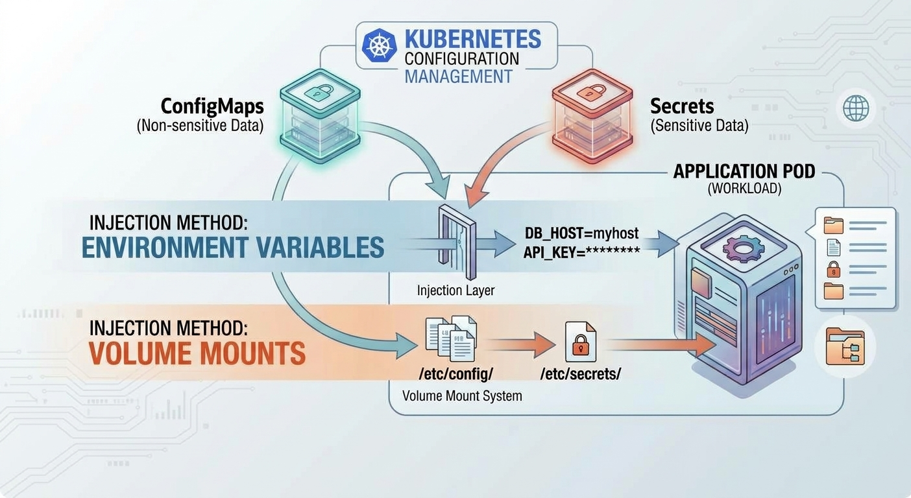
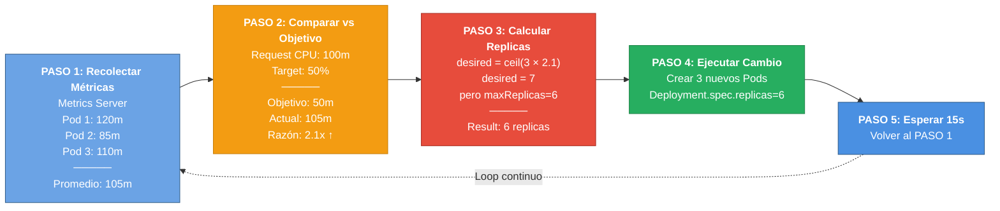
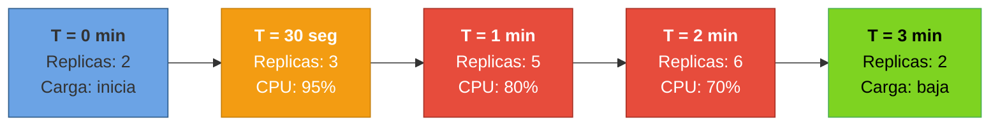

# 2.3 Configuración y escalamiento automático

En la sesión anterior analizamos cómo gestionar el ciclo de vida y la autocuración con _Deployments_ y _probes_ de salud, y ahora en esta sesión llevaremos ese conocimiento a la práctica al explorar _ConfigMaps_, _Secrets_ y escalamiento automático.

## 1. Explicación conceptual

En el desarrollo de aplicaciones _cloud-native_, separar el código ejecutable de su configuración es un principio fundamental (destacado en el factor III de _The Twelve-Factor App_). Una aplicación empaquetada en un contenedor debe ser inmutable y portable: el mismo artefacto o imagen de contenedor debe poder ejecutarse en desarrollo, _staging_ o producción sin recompilar.

### Configuración externa: ConfigMaps vs. Secrets

| Aspecto | ConfigMap | Secret |
|--------|-----------|--------|
| **Propósito** | Datos no confidenciales | Datos sensibles (credenciales, tokens, claves) |
| **Formato de almacenamiento** | Texto plano en `etcd` | Base64 en `etcd` (⚠️ No es encriptación) |
| **Casos de uso** | URLs, timeouts, feature flags, idioma de UI | Contraseñas de BD, API keys, JWT, certificados |
| **Inyección en contenedor** | Variables de entorno o volúmenes de archivo | Variables de entorno o volúmenes de archivo |
| **Actualización automática** | Archivos en volumen: Sí (~60s). Variables de entorno: No | Archivos en volumen: Sí (~60s). Variables de entorno: No |
| **RBAC/Seguridad** | Acceso público | Requiere políticas RBAC restrictivas |
| **Tamaño máximo** | 1 MB | 1 MB |
| **Encriptación en tránsito** | Opcional (HTTPS) | Recomendada (HTTPS + TLS) |
| **Encriptación en reposo** | No (por defecto) | No (por defecto, activar en etcd) |

**Detalles:**

- **ConfigMap:** Almacena datos no confidenciales en pares clave-valor o archivos completos (como `application.properties` de Quarkus). Permite ajustar comportamientos, URLs de servicios y parámetros de ejecución de forma independiente a la imagen.

- **Secret:** Almacena datos sensibles como contraseñas, _tokens_ JWT o claves API. A nivel de API, los valores están codificados en `base64`. Es importante enfatizar que `base64` **no es encriptación**, por lo que en producción se debe activar _Encryption at Rest_ en el _control plane_ (etcd) y gestionar el acceso mediante políticas estrictas de _Role-Based Access Control_ (RBAC).

Ambos objetos pueden inyectarse en los contenedores como **variables de entorno** o montarse como **volúmenes de archivos** (_volume mounts_).



### Observabilidad y recolección de métricas: Metrics Server

Para tomar decisiones dinámicas de escalamiento, el clúster necesita visibilidad sobre el consumo real de recursos. El **Metrics Server** es un componente del ecosistema que recolecta métricas de rendimiento de CPU y memoria de los agentes `kubelet` en cada nodo y las expone centralizadamente a través de la API `metrics.k8s.io`.

### Escalamiento en Kubernetes: HPA y VPA

- **Horizontal Pod Autoscaler (HPA):** Modifica dinámicamente el número de réplicas de un _Deployment_ o _StatefulSet_ en función de métricas observadas (como el porcentaje medio de uso de CPU o memoria). Opera mediante un bucle de control que calcula las réplicas necesarias con la fórmula:

$$\text{Replicas Deseadas} = \left\lceil \text{Replicas Actuales} \times \left( \frac{\text{Métrica Actual}}{\text{Métrica Objetivo}} \right) \right\rceil$$


- **Vertical Pod Autoscaler (VPA):** En lugar de agregar más réplicas, ajusta automáticamente los límites (_limits_) y solicitudes (_requests_) de CPU y memoria de los contenedores existentes.

_Prerrequisito crítico para HPA:_ Para que el _autoscale_ funcione correctamente, **todos los contenedores deben tener definidos sus `requests` de recursos** en el manifiesto, ya que el porcentaje de uso objetivo que evalúa el HPA se calcula con base en la solicitud (_request_) configurada y no sobre la capacidad total del nodo.

## Visualización: HPA Loop de escalamiento automático

Ahora visualizaremos cómo funciona en la práctica ese algoritmo de escalamiento automático que acabamos de describirte. El HPA toma la fórmula que mencionamos y la ejecuta de forma continua, adaptándose a cambios reales de carga.

### La fórmula en acción

Recuerda que el HPA calcula el número de réplicas deseadas usando esta ecuación:

$$\text{Replicas Deseadas} = \left\lceil \text{Replicas Actuales} \times \left( \frac{\text{Métrica Actual}}{\text{Métrica Objetivo}} \right) \right\rceil$$

Esta fórmula se ejecuta constantemente, y los siguientes diagramas muestran dos perspectivas de lo que sucede:

---

### Diagrama 1: El bucle de control HPA (cada 15 segundos)

Este diagrama muestra el **mecanismo interno** que ejecuta el controlador HPA en cada iteración. Estos 5 pasos se repiten continuamente para tomar decisiones de escalamiento:



**Punto clave:** Este bucle es **automático y continuo**. El controlador HPA no espera intervención manual; evalúa cada 15 segundos si se necesita cambiar el número de réplicas.

---

### Diagrama 2: Evolución observable (Black Friday)

Este diagrama muestra qué **ves en el mundo real** cuando sube y baja la carga. Es el resultado acumulativo de múltiples iteraciones del bucle anterior:



**Punto clave:** El **scaledown es lento** (~5 minutos por defecto) para evitar thrashing (oscilaciones rápidas de replicas). El scaleup es rápido (~15 seg) para responder a picos de demanda.

---

**Relación entre diagramas:**
- **Diagrama 1** responde: _¿Cómo decide HPA?_ → Muestra el mecanismo interno (el bucle de control)
- **Diagrama 2** responde: _¿Qué veo como operador?_ → Muestra cómo evoluciona el número de réplicas en el tiempo

---

### Ejemplo práctico: Aplicando la fórmula

Ahora veamos cómo la fórmula se aplica en un escenario real. Imagina que en el diagrama anterior, tu `inventory-service` tiene esta configuración:

```
Replicas Actuales = 3
CPU Actual = 105m
CPU Objetivo = 50m (100m request × 50% target)

Replicas Deseadas = ceil(3 × (105m / 50m))
                  = ceil(3 × 2.1)
                  = ceil(6.3)
                  = 7 (limitado a maxReplicas: 6)
                  = 6
```

**Requisitos críticos para HPA:**

✅ Deployment debe tener `resources.requests.cpu` definido  
✅ Metrics Server debe estar habilitado en el clúster  
✅ HPA debe tener minReplicas ≤ currentReplicas ≤ maxReplicas  

**Ventajas:**

✅ Responde automáticamente a picos de tráfico  
✅ Reduce recursos cuando no hay demanda (ahorra dinero)  
✅ No requiere intervención manual  
✅ Basado en métricas reales, no adivinanzas

## 2. Analogía del mundo real

Imagina la operación de una cadena de restaurantes de alta cocina:

- **El menú y la receta es la imagen de la aplicación:** La forma de cocinar el platillo no cambia de una sucursal a otra.

- **ConfigMap es el letrero con el horario y teléfono del local:** Información pública que varía según la ubicación (desarrollo o producción), pero que no necesita guardarse bajo llave.

- **Secret es la combinación de la caja fuerte del restaurante:** Información confidencial que solo el gerente autorizada debe conocer para abrir la caja al final del día.

- **Metrics Server es el supervisor con cronómetro:** Un observador que mide constantemente cuántos clientes hay en la fila y qué tan saturados están los cocineros en la cocina.

- **Horizontal Pod Autoscaler (HPA):** Si el supervisor nota que la cocina supera el 80% de su capacidad de atención, llama inmediatamente a más cocineros (agrega réplicas de _Pods_). Cuando baja la hora pico, envía a los cocineros extra a descansar para no malgastar recursos.

- **Vertical Pod Autoscaler (VPA):** En lugar de llamar más cocineros, el supervisor le da un sartén más grande y quemadores de alta potencia al único cocinero que ya está trabajando.

## 3. Laboratorio

Para completar esta parte, sigue el [Laboratorio de la clase 2.3](../02-laboratorio/laboratorio-clase-2-3.md). Allí encontrarás todos los pasos, código y procedimientos necesarios para crear ConfigMaps y Secrets, inyectar variables de entorno, configurar Horizontal Pod Autoscaler, desplegar manifiestos YAML y ejecutar pruebas de estrés para observar el autoscalado.

## 4. Reto de ingeniería o pregunta de reflexión

**Pregunta:** En Black Friday, tu plataforma e-commerce experimenta 10x más tráfico del normal. Sin HPA, tendrías que:
- Aumentar manualmente réplicas (lento, propenso a errores)
- O dejar que los Pods se abrumen y fallen (mala experiencia)

¿Cómo diseñarías una estrategia de escalamiento en dos niveles (CPU + memoria) que se adapte tanto a picos de demanda como a caídas súbitas, minimizando costos de infraestructura mientras garantizas SLA de 99.9%?

**Nota:** Esto te prepara para U3, donde agregarás `payment-service` y necesitarás escalamiento coordinado entre múltiples servicios.

**El escenario:**

Un equipo de desarrollo configuró un `ConfigMap` montado como volumen (_volume mount_) en la ruta `/deployments/config` de sus _Pods_ en Quarkus para leer un archivo de propiedades dinámicamente.

Al actualizar el `ConfigMap` en Kubernetes con un nuevo valor de tiempo de espera (_timeout_), notaron que los archivos del volumen dentro del contenedor sí se actualizaron automáticamente después de unos minutos. Sin embargo, la aplicación Java Quarkus continuó respondiendo con la configuración antigua.

**Para debatir en clase:**

1. ¿Por qué las variables de entorno inyectadas mediante `envFrom` o `valueFrom` **no** se actualizan automáticamente en un contenedor cuando cambia el `ConfigMap` fuente, mientras que los archivos en volúmenes montados sí lo hacen?

2. ¿Qué mecanismo o patrón arquitectónico (por ejemplo, utilidades dentro del framework o herramientas como _Reloader_ / _Stakater_) deberíamos implementar en nuestro _pipeline_ de CI/CD para garantizar que un cambio en un `ConfigMap` o `Secret` actualice de forma segura y sin _downtime_ la ejecución de la aplicación?
