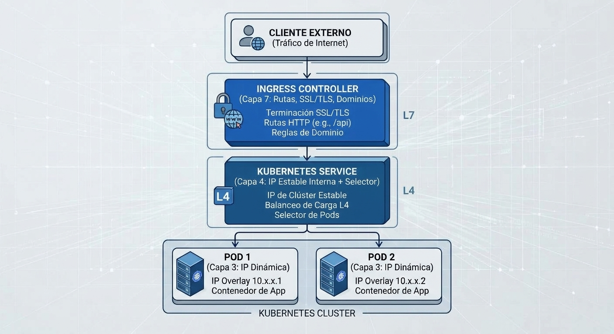
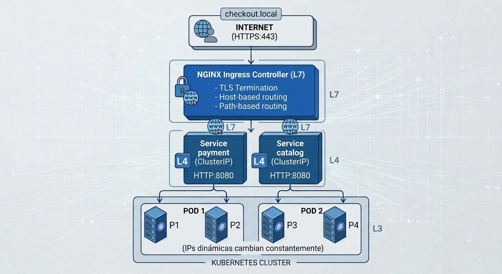
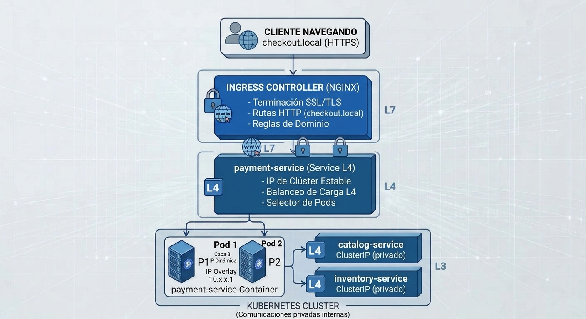

# 3.1 Balanceo de carga y acceso externo

En la sesión anterior analizamos cómo externalizar configuraciones y escalar réplicas dinámicamente con _ConfigMaps_, _Secrets_ y _HPA_, y ahora en esta sesión llevaremos ese conocimiento a la práctica al explorar _Services_, _Ingress_ y _Load Balancers_ para exponer nuestro clúster.

## 1. Explicación conceptual

En Kubernetes, los _pods_ son efímeros. Su dirección IP puede cambiar cuando un Pod se reemplaza o se programa de nuevo. Por eso, conectar un cliente directamente a la IP de un Pod no ofrece un destino estable.

Para resolver este problema de direccionamiento inestable, Kubernetes ofrece **Services** y recursos de entrada HTTP como **Ingress** y **Gateway API**.



El esquema representa una topología overlay concreta, no una exigencia de Kubernetes: la IP de Pod no implica que todos los clústeres usen overlay. `Ingress` y `Gateway` son recursos de API; el controlador implementa el proxy y el punto de entrada.

### 1.1 La capa de red de capa 4: Kubernetes Services

Un _Service_ es una abstracción que define un conjunto lógico de _pods_ y una política para acceder a ellos mediante etiquetas (_labels_). Funciona como un balanceador de carga interno de capa 4 (TCP/UDP) con una IP virtual fija (_ClusterIP_).

Existen cuatro tipos de objetos _Service_:

- **`ClusterIP` (por defecto):** Expone el servicio mediante una IP virtual del clúster, normalmente para consumo interno. Que un cliente externo pueda alcanzarla depende del enrutamiento de la plataforma; no es una forma estándar de exposición pública.

- **`NodePort`:** Expone el servicio en un puerto de cada nodo (por defecto del rango `30000-32767`). Puede formar parte de una arquitectura de entrada, por ejemplo detrás de un balanceador externo; por sí solo no proporciona nombres de dominio ni enrutamiento HTTP.

- **`LoadBalancer`:** Solicita un balanceador a una integración de infraestructura o proveedor. La disponibilidad de una dirección externa y la implementación del tráfico dependen de esa integración; algunas implementaciones utilizan `NodePort`, otras pueden enrutar de otra forma.

- **`ExternalName`:** Mapea el servicio a un nombre DNS externo (mediante un registro `CNAME`), sin usar _selectors_ ni _pods_ locales.

### 1.2 Entrada HTTP: Ingress y Gateway API

Aprovisionar un balanceador externo por cada microservicio puede no ser necesario. Los recursos **`Ingress`** y **Gateway API** permiten definir reglas HTTP/HTTPS hacia servicios del clúster; la infraestructura y los costos dependen del controlador y de la plataforma.

Un recurso `Ingress` describe reglas HTTP(S); no implementa por sí mismo el proxy ni el punto de entrada. Requiere un **Ingress Controller** que observe y aplique sus reglas. La API `Ingress` sigue estable, pero está congelada: Kubernetes recomienda **Gateway API** para nuevas funcionalidades y diseños nuevos.

Gateway API separa responsabilidades mediante recursos como `GatewayClass`, `Gateway` y `HTTPRoute`. Ambos modelos pueden describir enrutamiento por host y ruta y terminación TLS, sujeto a las funciones de la implementación elegida.

Las funciones adicionales, como reescritura de URLs, límites de solicitudes o autenticación, no son uniformes: dependen de las capacidades del controlador o de extensiones de la plataforma.

> **Nota de mantenimiento:** Ingress NGINX fue retirado en marzo de 2026 y ya no recibe correcciones ni actualizaciones de seguridad. La práctica de esta unidad usa Envoy Gateway con Gateway API; Ingress se conserva como concepto y API existente, no como recomendación de controlador nuevo.

---

## 2. Analogía del mundo real

Imagina un gran edificio corporativo de oficinas:

- **Los Pods:** Son los empleados trabajando en sus escritorios. Cambian de oficina, entran y salen constantemente.

- **ClusterIP:** Es la extensión telefónica interna. Si la extensión del área de finanzas es la `401`, llamas a ese número sin importar qué empleado conteste la llamada.

- **NodePort:** Es abrir una ventana en el piso 3 y colocar una escalera metálica que da a la calle. Cualquiera puede subir directamente a esa oficina específica, pero es incómodo, inseguro y se ve mal arquitectónicamente.

- **LoadBalancer:** Es contratar a un guardia de seguridad privado afuera del edificio que recibe a la gente en la banqueta y la canaliza por la escalera metálica correcta.

- **Controlador de entrada:** Es la recepción principal del edificio. El controlador aplica las reglas declaradas por `Ingress` o Gateway API y puede dirigir solicitudes por host o ruta; la terminación TLS depende de su configuración.

---

## 3. Arquitectura completa: Flujo de tráfico



Este diagrama usa NGINX como ejemplo de controlador existente; el Laboratorio 3.1 implementa el patrón con Envoy Gateway y Gateway API.

---

## 4. Caso de uso real: Plataforma E-commerce

Imagina una plataforma de e-commerce con 3 microservicios:

| Servicio | Tipo | Acceso | Propósito |
|----------|------|--------|-----------|
| **payment-service** | ClusterIP | Ingress → HTTPS | Procesar pagos (acceso externo) |
| **catalog-service** | ClusterIP | payment-service → HTTP | Datos de productos (privado) |
| **inventory-service** | ClusterIP | payment-service → HTTP | Stock de productos (privado) |

Con un **Gateway** implementado por un controlador, exponemos `payment-service` con TLS, mientras `catalog-service` e `inventory-service` permanecen como servicios internos, salvo que se configuren otras rutas de acceso.



El diagrama es una arquitectura conceptual, no los servicios desplegados en el laboratorio: el `payment-service` de la práctica devuelve una respuesta estática de demostración y no realiza pagos. Un controlador puede compartir infraestructura de entrada entre rutas y servicios. La cantidad de balanceadores, direcciones y certificados no está fijada por `Ingress` o Gateway API: depende del diseño, del controlador y de la plataforma.

“Privado” en este esquema indica que el servicio no tiene una ruta de entrada externa configurada; no implica que el tráfico interno esté cifrado.

---

## 5. Comparación: Ingress (API Legacy) vs. Gateway API (Recomendada)

### Contexto histórico

Kubernetes ha evolucionado en cómo expone servicios. Ambos modelos coexisten, pero con trajectoria diferente:

### Ingress (API congelada desde 2022)

**Características:**
- ✅ Estable, ampliamente soportado en clusters existentes
- ✅ Simple: un solo recurso (`Ingress`) define reglas HTTP/HTTPS
- ❌ API congelada (sin nuevas funcionalidades desde 2022)
- ❌ Ingeniería de Controladores: cada implementación (NGINX, Traefik, Kong) interpreta spec de forma ligeramente diferente
- ❌ **Ingress NGINX fue retirado en marzo 2026** y ya no recibe actualizaciones de seguridad

**Caso de uso típico:** Sistemas heredados que corren en clusters antiguos y no pueden migrar sin riesgo.

### Gateway API (Activamente desarrollada, recomendada desde 2023)

**Características:**
- ✅ API v1 estable desde agosto 2024 (aprobada por CNCF)
- ✅ Activamente desarrollada (nuevas funcionalidades cada release)
- ✅ Soporte creciente: Envoy Gateway, Kong, Nginx Gateway Agent, GKE, AWS ALB Controller
- ✅ Separa responsabilidades: `GatewayClass` (infraestructura), `Gateway` (listener config), `HTTPRoute` (reglas)
- ✅ Más flexible: permite extensiones, múltiples controladores, composición modular

**Caso de uso típico:** Nuevos despliegues, plataformas multi-proveedor, arquitecturas cloud-native.

### Comparación lado a lado

| Aspecto | Ingress | Gateway API |
|--------|---------|-------------|
| **Estado API** | Congelada (v1, sin cambios) | Activa (v1, evoluciona) |
| **Controladores** | NGINX (retirado 2026), Traefik, Kong | Envoy (v1.9.3), Kong, Nginx Agent |
| **Separación de responsabilidades** | No; todo en `Ingress` | Sí; `GatewayClass`, `Gateway`, `HTTPRoute` |
| **Extensiones** | Limitadas (annotations) | Extensiones nativas |
| **Portabilidad** | Media (annotations no portables) | Alta (recursos estándar) |
| **Recomendación CNCF** | Históricamente sí | Sí, actualmente |
| **Nuevo deployment** | ❌ No recomendado | ✅ Recomendado |

### En esta práctica

Usamos **Gateway API con Envoy Gateway** porque:
- ✅ Es el camino recomendado por Kubernetes SIG Network
- ✅ Envoy Gateway es estable, eficiente y seguro
- ✅ Preparas a estudiantes para arquitecturas modernas
- ✅ Evitas dependencias retiradas (NGINX)

Ingress sigue siendo un concepto válido que encontrarás en sistemas heredados, pero no es el punto de partida para nuevos diseños.

---

## 6. Laboratorio

Para completar esta parte, sigue el [Laboratorio de la clase 3.1](../02-laboratorio/laboratorio-clase-3-1.md). Allí crearás un endpoint HTTP estático de demostración, instalarás Envoy Gateway, configurarás recursos Gateway API y TLS, y validarás el acceso local. El TLS del laboratorio termina en el Gateway; el tramo Gateway–Pod usa HTTP y no demuestra cifrado de extremo a extremo.

---

## 7. Reto de ingeniería o pregunta de reflexión

**El escenario:**

Tu empresa mantiene una arquitectura heredada con cinco microservicios expuestos mediante un controlador Ingress NGINX y terminación TLS en el borde:

```text
Cliente → HTTPS:443 → Ingress Controller → HTTP:8080 → Pods (sin cifrado interno)
```

El equipo de seguridad exige cifrado también en el tramo entre el Gateway y los Pods, según el análisis de riesgos y los requisitos aplicables al entorno.

**Para debatir en clase:**

1. ¿Qué arquitectura usarías para cifrar el tramo Gateway–backend? Compara TLS hacia el backend con mTLS gestionado por una plataforma de identidad de cargas de trabajo. ¿Qué resuelve y qué no resuelve TLS Passthrough?

2. Si implementas mTLS con un service mesh, ¿qué ventajas operativas ofrece sobre distribuir y rotar manualmente certificados en cada Pod?

3. ¿Qué metadatos de solicitud puede seguir observando el Gateway cuando termina TLS y cómo protegerías los datos sensibles en esos registros?

## Fuentes primarias

- Kubernetes Authors. _Services_. <https://kubernetes.io/docs/concepts/services-networking/service/>
- Kubernetes Authors. _Ingress_. <https://kubernetes.io/docs/concepts/services-networking/ingress/>
- Kubernetes SIG Network. _Gateway API_. <https://gateway-api.sigs.k8s.io/>
- Kubernetes SIG Network. _Ingress NGINX Retirement_. <https://kubernetes.io/blog/2025/11/11/ingress-nginx-retirement/>
