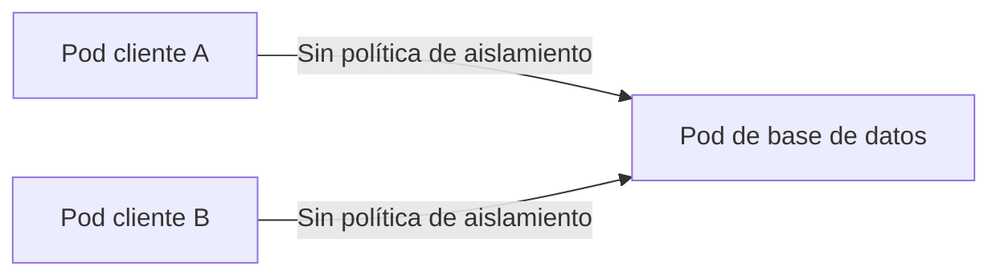
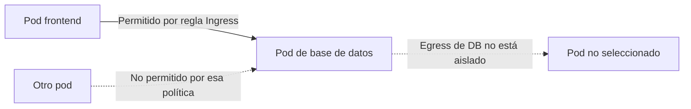

# 3.2 Redes del clúster y políticas de comunicación

En la sesión anterior analizamos cómo gestionar el tráfico de entrada mediante _Services_, _Ingress_ y terminación TLS, y ahora en esta sesión llevaremos ese conocimiento a la práctica al explorar _NetworkPolicies_, el CNI y el aislamiento del tráfico interno.

## 1. Explicación conceptual

A diferencia de la infraestructura tradicional donde las máquinas virtuales se aíslan con VLANs o subredes fijas, Kubernetes utiliza un modelo plano de red (_flat network_) gobernado por tres reglas fundamentales:

1. Cada _pod_ recibe una dirección IP única dentro del modelo de red del clúster, alcanzable desde los demás _pods_ según la implementación de red. La red no necesariamente es de tipo _overlay_.

2. Todos los _pods_ pueden comunicarse con cualquier otro _pod_ en el clúster **sin necesidad de NAT** (_Network Address Translation_).

3. Todos los nodos pueden comunicarse con todos los _pods_ del clúster sin NAT.

### 1.1 El motor subyacente: Container Network Interface (CNI)

Kubernetes integra la configuración de red de los _pods_ con plugins que implementan la especificación **CNI**. El modelo concreto de interfaces, direccionamiento y ruteo depende de la distribución y del plugin:

- **Flannel:** Plugin de red que suele crear una red _overlay_ (por ejemplo, con VXLAN). Flannel por sí solo no aplica `NetworkPolicy`; algunas distribuciones lo combinan con otro componente de políticas.

- **Calico:** Plugin de capa 3 (L3) altamente escalable que utiliza BGP (_Border Gateway Protocol_) para ruteo directo o encapsulamiento IP-in-IP/VXLAN. Implementa reglas de seguridad nativas.

- **Cilium:** Plugin de red que usa **eBPF** (_Extended Berkeley Packet Filter_) para procesar y aplicar políticas de red en el kernel de Linux. Puede ofrecer controles L7 y observabilidad de flujos cuando esas funciones están configuradas; no autentica por sí solo la identidad de las cargas de trabajo.

### 1.2 Aislamiento de red con NetworkPolicies

Si no hay una política aplicable, los _pods_ no están aislados para esa dirección de tráfico y se permite la comunicación. Este comportamiento no significa que todos los _pods_ estén expuestos a Internet: el acceso externo también depende de cómo se expongan los servicios y de la red del clúster.

Una **`NetworkPolicy`** define reglas de red de capa 3/4 para los _pods_ que selecciona mediante etiquetas (_labels_). Puede contribuir al principio de mínimo privilegio, pero por sí sola no implementa Zero Trust, no autentica identidades y no crea una ruta de acceso externo:

- **`Ingress`:** Controla qué tráfico entrante se permite hacia los _pods_ seleccionados.

- **`Egress`:** Controla qué tráfico saliente se permite desde los _pods_ seleccionados hacia otros _pods_, rangos CIDR o servicios externos.

### 1.3 Descubrimiento de servicios con DNS del clúster

Para evitar acoplarse a IPs dinámicas, los clústeres Kubernetes suelen configurar un servicio DNS interno, a menudo CoreDNS. El nombre del Service normalmente se puede resolver como nombre corto en el mismo namespace o como nombre de dominio completo (_FQDN_). El dominio de clúster de este ejemplo es el predeterminado habitual `cluster.local`, pero puede configurarse con otro valor:

```text
<nombre-servicio>.<namespace>.svc.cluster.local
```

Si dos microservicios conviven en el mismo _namespace_, suele bastar con invocar `<nombre-servicio>:<puerto-del-Service>`. El nombre, puerto y comportamiento DNS dependen de la configuración del clúster.

---

## 2. Analogía del mundo real

Imagina un gran edificio corporativo _open space_ sin paredes físicas interiores:

- **Modelo de red plano (IP por pod):** Todos los empleados caminan por el mismo pasillo principal. Cuestión de tiempo para que cualquiera pueda ir al escritorio de quien sea sin restricciones.

- **El CNI (El sistema de ventilación y accesos):**

    - _Flannel_ es poner tuberías de aire estándar. Cumple con llevar oxígeno pero no tiene puertas de seguridad.

    - _Calico_ es poner torniquetes con tarjetas magnéticas en cada pasillo.

    - _Cilium_ es instalar controles de tráfico programables en los accesos del edificio; con las funciones correspondientes configuradas, también permite observar los flujos.

- **NetworkPolicies (Reglas de acceso por etiquetas):** Una `NetworkPolicy` se parece a una lista de permisos que deja pasar a ciertos grupos según etiquetas del sistema, no a un lector biométrico que comprueba la identidad de una persona. Por ejemplo, puede permitir tráfico hacia los _pods_ seleccionados de `accounting` desde _pods_ de un _namespace_ etiquetado como `role: finance`.

- **CoreDNS (El directorio telefónico interno):** Nadie en la empresa se memoriza las extensiones de 10 dígitos de sus compañeros. Abres la libreta y buscas "Servicio de Inventario", e internamente el directorio te enlaza con la extensión actual de la persona, cambie de escritorio o no.

---

## 3. Aislamiento de red y Zero Trust

`Default Allow` y `Default Deny` describen el aislamiento de red de los _pods_ para una dirección concreta. No son modos globales del clúster: las políticas seleccionan _pods_ y pueden aislarlos para `Ingress`, `Egress` o ambos.

### 3.1 Default Allow: sin aislamiento para esa dirección

Si ninguna `NetworkPolicy` selecciona un _pod_ para `Ingress` (entrada) o `Egress` (salida), se permite el tráfico en esa dirección. No significa que una política bloquee automáticamente el tráfico considerado peligroso ni que el _pod_ quede publicado hacia Internet.



### 3.2 Default Deny: aislar _pods_ seleccionados y permitir explícitamente

Se configura, por ejemplo, con una política de `Ingress` que selecciona los _pods_ de la base de datos y no define reglas de entrada: esos _pods_ quedan aislados para el tráfico entrante. Luego, otras políticas pueden permitir los flujos necesarios. Las reglas de las políticas aplicables se combinan de forma aditiva; los _pods_ no seleccionados por ellas no cambian su comportamiento.



Para una conexión entre dos _pods_, se deben permitir las direcciones que estén aisladas: el `Egress` del origen y el `Ingress` del destino. El tráfico de respuesta de una conexión permitida se admite automáticamente. Una política de red no crea una ruta ni publica un servicio en Internet; la exposición externa se configura por separado mediante mecanismos como `Service` o `Ingress`.

### 3.3 Zero Trust: enfoque de seguridad complementario

Zero Trust es un enfoque más amplio que busca verificar cada acceso y aplicar el mínimo privilegio; no es un modo de `NetworkPolicy`. Puede combinar aislamiento de red con controles adicionales, según la arquitectura:

- **NetworkPolicy:** filtra tráfico de red por _pods_, _namespaces_, direcciones y puertos (capa 3/4), si el CNI implementa su cumplimiento.
- **Identidad y autenticación de cargas de trabajo:** verifican quién se comunica; por ejemplo, mediante mTLS cuando la plataforma lo soporta y está configurada.
- **Autorización y observabilidad:** determinan qué acciones se permiten y permiten registrar o analizar accesos mediante mecanismos específicos.

Por lo tanto, `Default Deny` puede ser una capa de una arquitectura Zero Trust, pero no proporciona por sí sola mTLS, autenticación, autorización de aplicación ni una garantía de “seguridad máxima”.

---

## 4. Protocolos y puertos comunes

En NetworkPolicies, especificas protocolo + puerto para cada regla:

| Servicio | Puerto | Protocolo | Típicamente Desde |
|----------|--------|-----------|------------------|
| **PostgreSQL** | 5432 | TCP | backend pods en namespace: production |
| **Redis** | 6379 | TCP | app pods, cache services |
| **DNS del clúster** | 53 | UDP y TCP | Pods que necesitan resolver nombres; destino según la arquitectura DNS del clúster |
| **HTTPS de entrada** | 443 | TCP | Listener del Gateway/controlador; el camino externo depende de la arquitectura del clúster y del CNI |
| **Prometheus** | 9090 | TCP | monitoring namespace |
| **Etcd** | 2379 | TCP | solo control plane (muy restrictivo) |

```yaml
# Ejemplo: Permitir PostgreSQL solo desde pods de aplicación en namespaces backend
spec:
  policyTypes:
    - Ingress
  podSelector:
    matchLabels:
      app: postgres
  ingress:
  - from:
    - namespaceSelector:
        matchLabels:
          role: backend
      podSelector:
        matchLabels:
          tier: application
    ports:
    - protocol: TCP
      port: 5432
```

---

## 5. Observabilidad de las políticas de red

Una `NetworkPolicy` define las reglas; la aplicación y observabilidad del tráfico dependen del CNI y de las herramientas que se configuren. El plano de control de Kubernetes almacena los objetos de política, pero no registra por defecto cada paquete permitido o denegado.

- **CNI:** Consulta la telemetría o los registros que ofrezca el CNI. Por ejemplo, Cilium puede mostrar flujos con Hubble cuando está instalado y configurado.
- **Prometheus + Grafana:** Permiten visualizar métricas de red si el CNI o sus componentes exportan las métricas necesarias.
- **Ingress Controller:** Sus logs describen solicitudes HTTP que llegan al controlador; no son un registro general de paquetes bloqueados por `NetworkPolicy`.
- **Auditoría de Kubernetes:** Registra solicitudes al API Server, como cambios a los objetos `NetworkPolicy`; no registra los paquetes que el CNI descarta.

El efecto visible de un flujo denegado (por ejemplo, timeout o error de conexión) depende de dónde y cómo el CNI aplique la política. No se debe asumir que el cliente recibe siempre un TCP RST.

---

## 6. Laboratorio

Para completar esta parte, sigue el [Laboratorio de la clase 3.2](../02-laboratorio/laboratorio-clase-3-2.md). Allí verificarás el soporte de NetworkPolicy del CNI, aislarás el servicio de demostración, permitirás el tráfico desde el proxy de datos de Envoy Gateway y validarás reglas inter-servicios/DNS de forma opcional.

---

## 7. Reto de ingeniería o pregunta de reflexión

**El escenario:**

Tu organización implementó una `NetworkPolicy` de Default Deny All en el namespace `production` hace 3 meses. Durante ese tiempo, los equipos de aplicación han desplegado nuevos microservicios sin coordinación centralizada con el equipo de infraestructura.

Hoy, un nuevo microservicio `analytics-processor` fue desplegado, pero **no puede conectarse a la base de datos PostgreSQL en el namespace `data`**. El equipo de aplicación reporta: *"Fue hace meses que funcionaba todo, ¿por qué ahora no?"*

**Para debatir en clase:**

1. ¿Cómo diseñarías un sistema de approval/governance para que las NetworkPolicies cambien solo con validación del equipo de infraestructura? ¿Qué herramientas (GitOps, admission webhooks, OPA) facilitarían esto?

2. Si la conexión debe ser `analytics-processor` (en `production`) → PostgreSQL (en `data`), escribe la `NetworkPolicy` que permitiría exactamente esa comunicación sin exponer el puerto 5432 a otros servicios.

3. ¿Cómo habrías detectado este problema **antes** de que el analytics-processor fuera desplegado en producción? Propón una estrategia de testing de NetworkPolicies en staging.

## Fuentes primarias

- Kubernetes Authors. _Network Policies_. <https://kubernetes.io/docs/concepts/services-networking/network-policies/>
- Kubernetes Authors. _Cluster Networking_. <https://kubernetes.io/docs/concepts/cluster-administration/networking/>
- Kubernetes Authors. _DNS for Services and Pods_. <https://kubernetes.io/docs/concepts/services-networking/dns-pod-service/>
- Cilium. _Network Policy_. <https://docs.cilium.io/en/stable/security/policy/>
